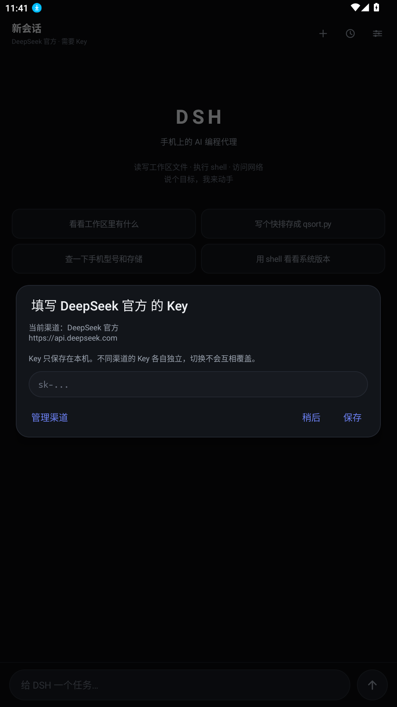
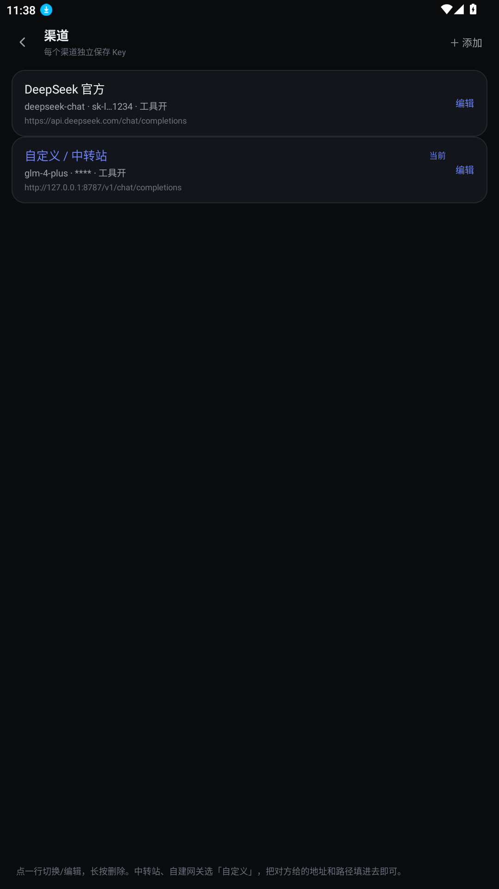
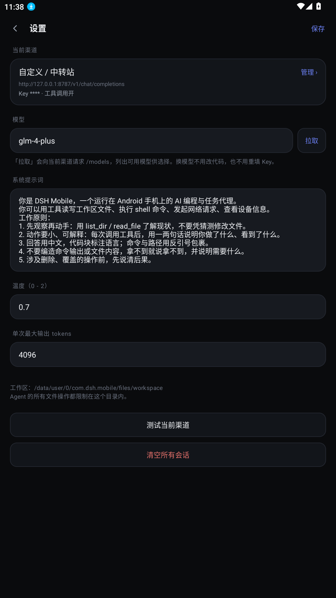
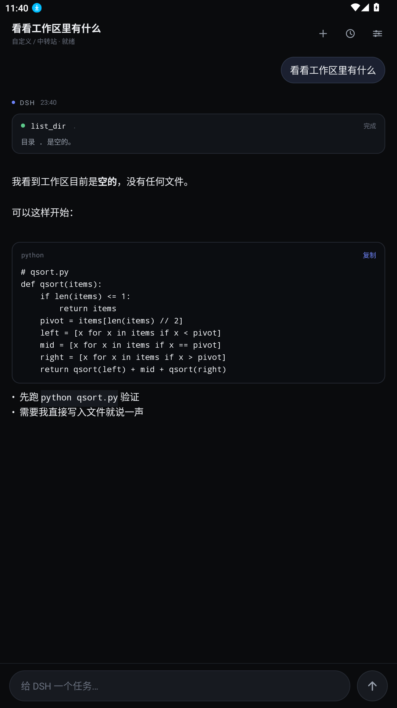
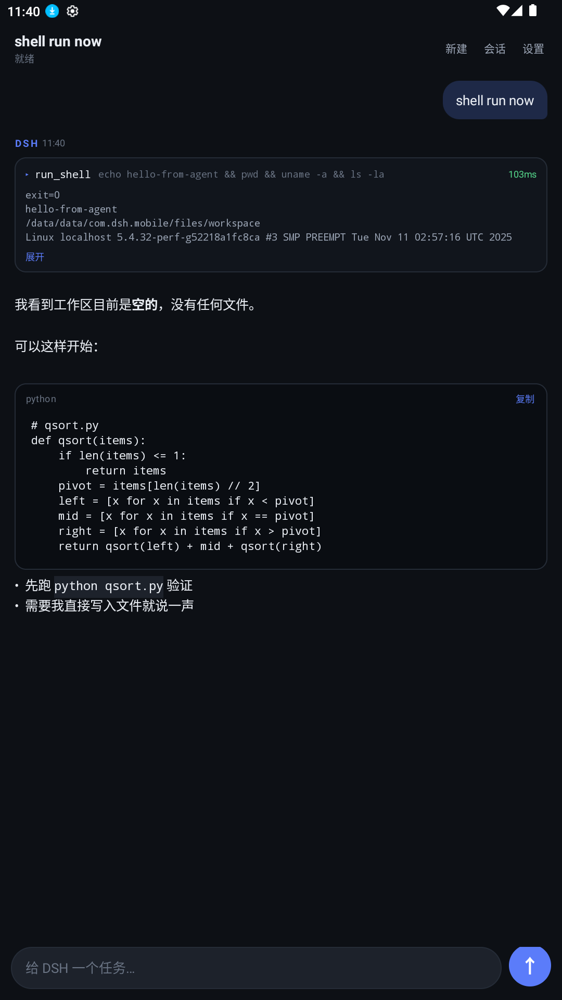

# DSH Mobile

把 DSH 的体验搬到 Android 手机上：一个能**真的动手**的 AI 编程与任务代理 —— 会话、流式输出、代码块、
工具调用卡片，以及一个被沙箱限制的本地工作区。

原生 Android（Java + 系统框架 API，**零第三方依赖**），APK 只有 ~90 KB。
支持**多渠道**：DeepSeek 官方、硅基流动、OpenRouter、Kimi、百炼、智谱、火山方舟、本地 Ollama，
以及任意自定义中转站 —— 每个渠道的 Key 独立保存，随时切换。



## 多渠道 / 换 Key

点「设置 → 当前渠道 → 管理」，进入渠道列表。每个渠道 = 一套 **接口地址 + 请求路径 + 鉴权方式 + Key + 模型**。



- **新增**：右上角「＋ 添加」→ 选一个预设（或「自定义 / 中转站」）→ 填 Key 即可。
- **切换**：点列表里的一行，主界面状态栏会显示当前渠道名。
- **编辑**：点右侧「编辑」，或长按行选「编辑配置」。
- **删除**：长按行 → 删除（至少保留一个渠道）。
- **拉取模型**：编辑页点「拉取」，直接请求该渠道的 `/models` 并弹列表选择，不用手敲模型名。
- **测试连接**：编辑页/设置页的「测试连接」会请求 `/models`，返回模型数量与前几个名字。

| 预设 | 接口地址 | 默认模型 |
| --- | --- | --- |
| DeepSeek 官方 | `https://api.deepseek.com` | `deepseek-chat` |
| 硅基流动 SiliconFlow | `https://api.siliconflow.cn/v1` | `deepseek-ai/DeepSeek-V3` |
| OpenRouter | `https://openrouter.ai/api/v1` | `deepseek/deepseek-chat` |
| Kimi / 月之暗面 | `https://api.moonshot.cn/v1` | `moonshot-v1-8k` |
| 阿里云百炼 | `https://dashscope.aliyuncs.com/compatible-mode/v1` | `qwen-plus` |
| 智谱 GLM | `https://open.bigmodel.cn/api/paas/v4` | `glm-4-plus` |
| 火山方舟（豆包） | `https://ark.cn-beijing.volces.com/api/v3` | 填接入点 ID（`ep-…`） |
| 本地 Ollama / LM Studio | `http://127.0.0.1:11434/v1` | 无需 Key |
| 自定义 / 中转站 | 自己填 | 自己填 |

**中转站怎么填**：以对方给的地址为准。如果给的是 `https://xx.com/v1`，接口地址填它、请求路径留
`/chat/completions`；如果给的是完整 `https://xx.com/v1/chat/completions`，把整条贴进「请求路径」也能用
（程序会识别完整 URL）。

**兼容性处理**（这些是踩过坑的）：

- 有的渠道/模型不接受 `tools`，会返回 400。程序会自动**去掉工具重试一次**，并提示"本轮已按普通对话处理"，
  不会让你卡在报错上。也可以在渠道设置里直接关掉工具调用。
- 少数渠道声称流式却返回整包 JSON，程序会自动识别并按整包解析，不会显示空白。
- `reasoning_content` 与 OpenRouter 风格的 `reasoning` 字段都能识别。
- Azure 风格用 `api-key` 请求头鉴权，可在「鉴权方式」里切换；本地模型选「无需鉴权」。
- 特殊中转要求额外标记时，可在「额外请求头」里按 `Header: value` 每行一条填写。



> 从 1.0 升级时，原来的单个 Key / 地址 / 模型会自动迁移成第一个渠道，不会丢失。

## 它和普通"AI 聊天 App"的区别

普通聊天 App 只会回文字；这个会调用工具、在手机上真的执行，然后把结果接回对话继续推理：



工具调用以卡片形式内联在回答里，可展开看完整输出、可计耗时。多步任务（观察 → 改文件 → 再验证）会在同一轮里自动连续跑，最多 12 步。

## 功能

- **流式输出**：SSE 逐字显示，带光标；可随时按 `■` 停止，已生成的部分保留。
- **Function Calling 工具循环**：模型决定调用 → 本地执行 → 结果回灌 → 继续生成，直到给出最终答复。
- **多渠道**：每个渠道独立保存 Key 与模型，切换互不覆盖（见上）。
- **内置 8 个工具**（见下表），全部在设备本地执行。
- **会话管理**：本地保存、自动按首条消息命名、可切换/删除，切换界面不中断正在跑的任务。
- **Markdown 渲染**：代码块（带语言标签 + 一键复制）、行内代码、标题、列表、粗体、链接。
- **思考过程**：`deepseek-reasoner` 的 `reasoning_content` 折叠展示，可选展开。
- **可配置**：温度、最大输出、系统提示词对所有渠道生效；Key/地址/模型按渠道隔离。

## 视觉约定

不是"加装饰"，而是靠**减少变量**换取高级感：

- **两色体系**：石墨黑 `#0A0B0D` + 单一强调色 `#6D82F7`。强调色只出现在发送键、当前渠道、链接和流式光标上，
  其余全部是中性灰阶，避免彩色噪声。
- **只用一个层级手段**：1px 发丝描边（`#232730`）配 14–20dp 圆角。不用阴影、外发光、彩色气泡。
- **字号阶**：标题 15.5 / 正文 15 / 辅助 11 / 微标 10.5sp；正文行距放大到 1.4 倍，中文更透气。
- **留白节奏**：屏幕左右 18dp，消息间距 22dp，卡片内边距 14dp，都取 4 的倍数。
- **顶栏图标化**：新建 / 会话 / 设置改成 20dp 线性图标，40dp 触控区，配 `contentDescription`。
- **弱化身份行**：助手消息不再用彩色名字，改为 5dp 强调色圆点 + 10.5sp 的 `DSH` 与时间。
- **发送键三态**：空输入灰 / 有内容蓝渐变 / 执行中停止键（矢量图标，字体放大不裁切）。

## 内置工具

| 工具 | 作用 | 说明 |
| --- | --- | --- |
| `read_file` | 读工作区文本文件 | 上限 400 KB |
| `write_file` | 写/覆盖文件 | 自动建父目录 |
| `replace_in_file` | 精确字符串替换 | 适合改代码，支持全部替换 |
| `list_dir` | 列目录 | 目录在前，带大小 |
| `delete_file` | 删文件 / 空目录 | 不能删工作区根目录 |
| `run_shell` | `/system/bin/sh -c` | 工作目录=工作区，默认 20s 超时，输出截断 120KB |
| `http_request` | 发 HTTP 请求 | 支持 GET/POST |
| `device_info` | 机型/系统/屏幕/存储 | — |

**沙箱边界**：文件类工具被限制在 `/data/data/com.dsh.mobile/files/workspace/`（越界路径直接拒绝）。
`run_shell` 受 Android 应用沙箱约束，只能读系统级公开信息，**没有 root**，无法访问其它应用的数据。

## 安装到手机

APK 在 `dist/dsh-mobile.apk`。任选一种方式传到手机：

1. **USB**：连上手机，`adb install -r dist/dsh-mobile.apk`
2. **文件传输**：把 APK 拷到手机（微信文件传输 / 网盘 / 数据线），在文件管理器里点开安装
3. 手机上需要允许"安装未知来源应用"

首次打开会要求填当前渠道的 API Key。Key 只存本机 `SharedPreferences`，不写进代码、不上传第三方。

> 这个 APK 用调试证书签名，适合个人自用；若要分发，请用你自己的 keystore 重新签名。

## 使用

- 输入框给目标，点右侧圆形按钮发送；执行中它会变成停止键。
  按钮有三态：空输入时是灰色 → 有内容变蓝色渐变 → 执行中变成灰色停止方块（矢量图标，字体放大也不会裁切）。
- 右上角：**新建** / **会话** / **设置**。
- 工具卡片点"展开"看完整输出；代码块右上角"复制"一键复制。
- 建议先试：「看看工作区里有什么」「写个快排存成 qsort.py」「用 shell 看看当前目录和系统版本」。




## 从源码构建

不依赖 Gradle / Android Studio / Maven，全部走 aapt2 + javac + d8 + apksigner：

```powershell
# 需要：JDK 17+（脚本默认用 PyCharm 自带的 JBR，可改 $JavaHome）
#       Android build-tools 36.0.0 + platforms/android-34
pwsh -File build.ps1
```

产物：`dist/dsh-mobile.apk`

构建链路：

```
aapt2 compile  ->  aapt2 link (+R.java)
               ->  javac --release 8
               ->  d8 --min-api 24
               ->  打包 classes.dex -> zipalign -p 4 -> apksigner
```

几个踩过的坑（脚本里已处理）：

- **PowerShell 5.1 按 ANSI 读脚本**：含中文的 `.ps1` 必须存成 UTF-8 **带 BOM**，否则解析报错。
- **javac 的 `@file` 列表不能带 BOM**：BOM 会被当成第一个文件名的字符，改为直接传参数。
- **R8/d8 8.2.2 有 bug**：解析"实例方法里捕获 this 的匿名内部类"时 NPE，必须用 build-tools 36 的 d8（8.10）。
- **keytool 的正常提示走 stderr**：在 `$ErrorActionPreference = "Stop"` 下会被当成错误中断，需局部放宽。

## 离线自测（不花 token）

`tools/mock-server.js` 是本地模拟 OpenAI 兼容接口的服务，可当任意渠道接入：

```powershell
node tools/mock-server.js                  # http://0.0.0.0:8787
adb reverse tcp:8787 tcp:8787              # 让手机的 127.0.0.1:8787 指向电脑
```

在「渠道 → 自定义」里填接口地址 `http://127.0.0.1:8787`、路径 `/v1/chat/completions`、随便一个 Key，
即可完整验证流式、工具调用、二次回答。消息里带 `downgrade` 会模拟"渠道不支持工具"的 400，用来测自动降级；
带 `shell` 会触发 `run_shell` 工具。

## 项目结构

```
app/src/main/
  AndroidManifest.xml
  java/com/dsh/mobile/
    MainActivity.java        聊天主界面（feed / 输入 / 首次引导）
    SessionsActivity.java    会话列表
    SettingsActivity.java    设置（渠道卡片 / 模型 / 全局参数）
    ProvidersActivity.java   渠道列表（切换 / 添加 / 删除）
    ProviderEditActivity.java 渠道编辑（地址、路径、Key、模型、鉴权、工具开关）
    core/
      Config.java            全局配置 + 渠道仓库入口
      Provider.java          一个渠道的模型（URL 拼接、鉴权头、掩码）
      ProviderStore.java     渠道持久化 + 旧版单 Key 迁移（进程内单例）
      Presets.java           各渠道预设模板
      ModelsApi.java         /models 拉取 + 连通性测试
      Message.java           消息模型（含 reasoning / toolCalls）
      ToolCall.java          工具调用 + 执行结果
      Session.java           会话模型
      SessionStore.java      JSON 持久化（原子写）
      ChatApi.java           SSE 流式客户端、tool_calls 合并、降级与非流式兜底
      Agent.java             单例主循环（流式 → 工具 → 再推理）
      LocalTools.java        8 个本地工具 + 沙箱
    ui/
      Md.java                极简 Markdown → Spannable
      MessageRow.java        气泡 / 代码块 / 工具卡片渲染
  res/                       深色主题、drawable、布局、图标
build.ps1                    一键构建
tools/mock-server.js         本地 mock 接口
```

## 已知限制

- 只支持 OpenAI 风格的 `/chat/completions`。Claude 原生 API、Gemini 原生 API 格式不同，走中转站的兼容层可以，
  直连需要另写适配。
- `deepseek-reasoner` 不支持工具调用；用它的渠道建议关掉工具开关。
- 文件工具只在自己应用目录内；想操作公共存储需要额外做 SAF 授权（未实现）。
- 没有工具调用审批环节（DSH 桌面端有），模型说调就调；敏感操作建议在系统提示词里约束。
- 竖屏锁定；无暗色/亮色切换（固定深色）。

## 后续可以做的

- 工具调用前的人工确认（类似 DSH 的 approve/deny）
- 渠道级系统提示词（不同模型用不同 prompt）
- 公共目录访问（Storage Access Framework）
- 文件差异（diff）视图，用于 `replace_in_file`
- 语音输入、图片理解（多模态渠道）
